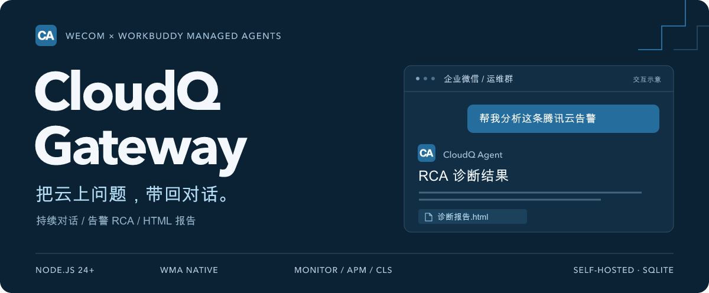
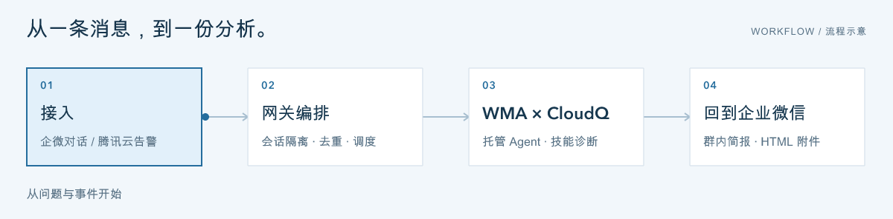

<p align="center">
  
</p>

<h1 align="center">企业微信 CloudQ 运维网关</h1>

<p align="center">
  <strong>在企微里提问，让 Agent 接手诊断，把结果送回群里。</strong><br>
  企业微信长连接 × WorkBuddy Managed Agents × 腾讯云可观测
</p>

<p align="center">
  <a href="#quick-start">快速开始</a> ·
  <a href="#capabilities">功能亮点</a> ·
  <a href="#workflow">工作流程</a> ·
  <a href="docs/guide.md">完整指南</a> ·
  <a href="docs/guide.md#development">参与开发</a>
</p>

---

把企业微信变成云上运维的对话入口：平时与 Agent 持续交流，告警发生时自动执行根因分析（RCA），再将简报与 HTML 报告推送到指定群。

网关部署在你自己的 CVM / IDC，通过 **WebSocket 长连接**收发企微消息，通过 **WMA 云 API + ACP SSE**执行 Agent。CloudQ 等技能、工具和业务提示词在 WMA 侧配置，网关负责接入、编排与交付。

<a id="capabilities"></a>

## 不止于把消息转给 AI

| 对话入口 | 诊断工作流 | 结果交付 |
| --- | --- | --- |
| **一个入口，多组 Bot**<br>扫码创建或绑定已有机器人。每个 Bot 绑定一个 WMA Agent，支持多个 Bot 复用同一 Agent。 | **告警来了，自动分析**<br>接入云产品监控、APM、CLS，选择策略、去重轮询，每条告警使用独立诊断会话。 | **结论回到协作现场**<br>回复原对话，或主动推送到绑定群；告警推送失败可自动退避重试。 |
| **上下文持续，边界清晰**<br>单聊复用会话，群聊可共享或按用户隔离。支持流式回复、思考过程开关、`/new` 与 `/stop`。 | **版本与凭证显式管理**<br>跟随 WMA 路由或固定版本；从所选源版本创建凭证注入版，选择并保存后生效。 | **报告直接变成附件**<br>将 Agent 输出的完整 HTML 转成文件发送。无需额外网页托管，告警附件可持久化重试。 |

<a id="workflow"></a>

## 接入 → 编排 → 诊断 → 交付

<p align="center">
  <a href="docs/assets/pipeline.png">
    
  </a>
</p>

<p align="center"><sub>流程动图为功能示意。<a href="docs/assets/pipeline.png">查看静态版</a></sub></p>

**日常对话**保留会话上下文；**自动告警**创建独立 WMA Session。两条路径共用 Bot 与 Agent 配置，诊断结果各回各的对话或绑定群。

<details>
<summary><strong>展开查看实际连接架构</strong></summary>

```text
企业微信单聊 / 群聊                    腾讯云 Monitor / CLS
        ⇅ WebSocket                            ↑ 轮询策略与历史
        └────────────────┐   ┌─────────────────┘
                         ↓   │
                    Node.js 网关
              Bot 配对 · 会话队列 · 告警任务
              Web 管理台 · HTML 交付 · SQLite
                         ⇅ 腾讯云 API 3.0 / ACP SSE
                    WMA 托管 Agent
                  CloudQ 等技能与工具
```

企业微信接入无需公网回调 URL，不依赖 SCF 或 Redis。主机仍需允许企业微信、WMA 和所选告警来源的出站访问；[查看网络清单](docs/guide.md#env-network)。

</details>

<a id="quick-start"></a>

## 从部署到第一条回复

准备一台能访问企业微信与腾讯云 API 的主机、Docker Compose，以及已发布并开启公网 API 的 WMA Agent。

```bash
git clone --branch main https://cnb.woa.com/buddy-op/wecom-cloudq-gateway.git
cd wecom-cloudq-gateway
cp .env.example .env
# 编辑 .env，设置高强度 ADMIN_PASSWORD
./deploy.sh
```

打开 **`http://<主机内网 IP>:3000/admin`**，用 `.env` 中的管理账号登录，跟随向导完成三步：

| 步骤 | 配置 | 完成后 |
| --- | --- | --- |
| **01** | 添加 WMA AK/SK 凭证 | 拉取凭证可见的 Agent |
| **02** | 选择 WMA Agent | 绑定执行入口，按需选择版本 |
| **03** | 扫码创建或绑定企微 Bot | 等待连接状态变为 `authenticated` |

向 Bot 发送「你好」，再问「我刚才问了什么」，验证上下文复用。后续更新在源码目录执行 `./deploy.sh` 即可。

**部署约束：**使用单实例，持久化 SQLite 数据卷；管理端口仅向可信网络开放。直接运行需要 Node.js **24+**。[完整部署说明 →](docs/guide.md#deployment)

## 把它放进你的运维流程

### 让告警自己进入诊断

在管理台添加腾讯云凭证，选择 **Monitor / APM / CLS** 来源与策略，再选择执行 Bot。保存后，将该 Bot 加入告警群并发送页面生成的绑定指令：

```text
@运维助手 /bind-alert A7K92F
```

绑定码为示例，请使用当前配置生成的指令。执行「测试推送」与「立即轮询」验证链路后，后续新告警按配置自动处理。默认每 **60 秒**轮询，首次回溯 **10 分钟**，重叠窗口 **5 分钟**。[配置告警 RCA →](docs/guide.md#alert-rca)

### 让分析带着报告回来

在 Bot 对话或告警诊断 Prompt 中提出交付要求：

> 分析这条告警，先给出结论、证据与排查建议，再生成完整 HTML 诊断报告，以附件发送。

网关会引导 Agent 输出完整源码，转成 UTF-8 `.html` 附件。每轮最多 **5 个文件 / 合计 5 MiB**，并受模型输出长度限制。[查看附件协议与限制 →](docs/guide.md#html-reports)

## 继续探索

| 我想…… | 从这里开始 |
| --- | --- |
| 调整群聊隔离、会话与思考过程显示 | [Bot 与对话设置](docs/guide.md#bot-setup) |
| 固定 WMA 版本，或创建云凭证注入版 | [版本与运行时凭证](docs/guide.md#wma-versions) |
| 设置来源、策略、Prompt 与诊断凭证 | [告警 RCA](docs/guide.md#alert-rca) |
| 调整环境变量、端口或出站网络 | [环境与网络](docs/guide.md#env-network) |
| 备份数据库、从 CloudAgent 旧版升级 | [数据与升级](docs/guide.md#operations) |
| 本地开发、运行测试或构建管理台 | [开发指南](docs/guide.md#development) · [前端说明](web/README.md) |
| 阅读消息、Agent、告警与存储实现 | [代码导航](docs/guide.md#code-map) |

<details>
<summary><strong>运行边界与数据说明</strong></summary>

- Bot Secret 和 AK/SK 明文保存在本机 SQLite 中，管理 API 不回显密钥；请保护主机、数据卷与备份。
- 凭证注入版会将 AK/SK 写入 WMA 云端版本；CloudQ 诊断凭证会发送到所选 Agent 的会话。具体行为见[凭证说明](docs/guide.md#wma-versions)。
- 文件与图片上传、Agent 交互式授权或追问尚未接入。HTML 附件只交付完整文档和正常结束任务的结果。
- 告警历史轮询不保证覆盖所有长期告警的恢复状态。诊断、模型输出与云资源权限由所选 WMA Agent 及技能决定。
- 当前 `main` 为 WMA 版本，原 CloudAgent 主线保存在 `CloudAgent-version`。Compose 项目名和数据卷保留历史命名，升级前请备份。

</details>

---

<p align="center">
  <strong>问题在云上，协作在群里。</strong><br>
  <sub>Self-hosted gateway · Powered by WorkBuddy Managed Agents</sub>
</p>
